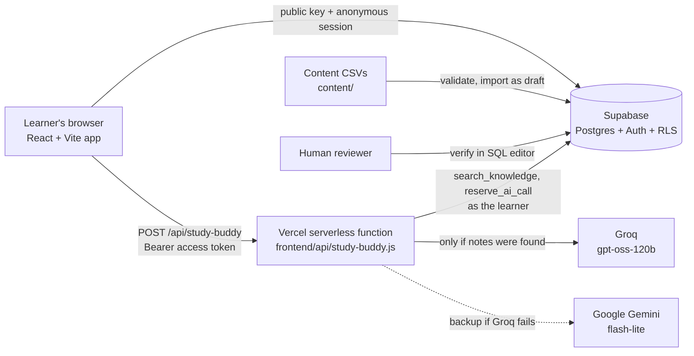

# Architecture

Everything here is taken from the code in this repository. See [`PRD.md`](../PRD.md) for what we build and why, [`API_CONTRACTS.md`](API_CONTRACTS.md) for request and response shapes.

## Big picture

## Pieces
| Part | Where | Notes |
|---|---|---|
| Web app | `frontend/src/` | React 19, Vite 8, HashRouter. Pages: Home `/`, Quiz `/quiz`, Readiness `/dashboard`, Ask Buddy `/study-buddy`. Reads questions and saves attempts directly through Supabase with the public key. |
| Study Buddy endpoint | `frontend/api/study-buddy.js`, `frontend/server/` | Vercel serverless function. Core logic in `studyBuddyCore.js`, prompt in `studyBuddyPrompt.js`, providers in `providers.js`. |
| Health check | `frontend/api/health.js` | Reports whether environment variables are set and whether Supabase is reachable. Never returns a key. |
| Database | `supabase/migrations/` | Tables: `domains`, `objectives`, `questions`, `notes`, `attempts`, `app_settings`, `ai_usage`. All have Row Level Security. |
| Content pipeline | `content/`, `scripts/validate_content.mjs`, `backend/importer/import.js` | CSV, then validate, then import as `draft`, then verify by a second person. |
| Tests | `frontend/server/study-buddy.test.mjs`, `frontend/src/lib/safeUrl.test.mjs`, `backend/tests/run_tests.js` | Offline endpoint tests (23), link-safety tests, and a retrieval/full-answer harness for real questions. |
| CI | `.github/workflows/ci.yml` | Runs the offline tests, build, lint, content validation and a secrets scan on every pull request. |

## Data model (short)
- `objectives` is seeded from `content/objectives.json` (3 domains, 11 groups, 57 objectives).
- `questions` and `notes` carry `status` (`draft` or `verified`), `source_url`, `author`, `verified_by`. The database refuses `verified` without a source URL, an explanation, and a reviewer other than the author. Source URLs must start with `https://learn.microsoft.com/`.
- `attempts` stores `question_id` and `selected_index`; a trigger sets `is_correct` and another limits writes to 500 per learner per hour.
- `app_settings` holds the caps (`ai_user_daily_cap` 20, `ai_global_daily_cap` 200, `readiness_min_attempts` 5). `ai_usage` records AI calls. Neither is readable from the browser.

## Key database functions
| Function | Security | Purpose |
|---|---|---|
| `search_knowledge(query_text, match_count)` | invoker, empty search_path | Postgres full-text search over verified notes and verified question explanations. Keeps only passages matching at least half of the question's meaningful words. Callable by signed-in learners (anonymous sign-in counts); the `anon` role cannot run it. |
| `get_readiness()` | definer | Per-domain accuracy from the learner's latest attempt at each question, and a weighted overall figure. |
| `reserve_ai_call()` | definer | Checks and records the per-learner and global daily caps under an advisory lock. |

Retrieval improvements under test are in `supabase/candidates/` and are not applied automatically.

## How a Study Buddy answer is produced
1. The browser sends the question (3 to 500 characters) with the learner's access token.
2. The function validates it, then calls `search_knowledge` as the learner (so Row Level Security applies).
3. **Nothing found:** return a polite refusal with a Microsoft Learn link. No AI call is made.
4. **Cached answer:** an in-memory cache (6 hours, up to 200 entries, per function instance) can answer repeats. It is not shared between instances, so a cold start can miss it.
5. `reserve_ai_call` checks the daily caps. If a cap is reached, the learner sees a limit message.
6. The prompt contains only the numbered passages and the question; Groq answers first, Gemini is the backup.
7. The answer is accepted only if it cites at least one real passage number. Invented numbers are removed; an answer with no citation is replaced by a refusal. The model can also reply `NOT_IN_NOTES`.
8. The response carries the answer and its sources (objective id and Learn link).

## Security boundaries
- Browser: public Supabase key only. Row Level Security is the real gate.
- Vercel function: holds the AI keys and never returns them. Error responses are generic.
- Supabase: secret key never leaves the team lead's laptop (used only by the importer).
- Headers: a Content Security Policy and related headers are set in `frontend/vercel.json`.
Details and findings: [`SECURITY_REVIEW.md`](SECURITY_REVIEW.md).

## Deployment
Vercel builds from `main` with Root Directory `frontend/`. `VITE_` variables are baked in at build time, so changing them needs a redeploy. Supabase migrations are applied by hand in the SQL editor, in filename order (preview databases are disabled in `supabase/config.toml`).
